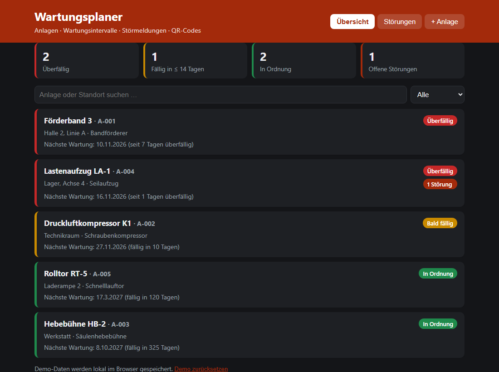
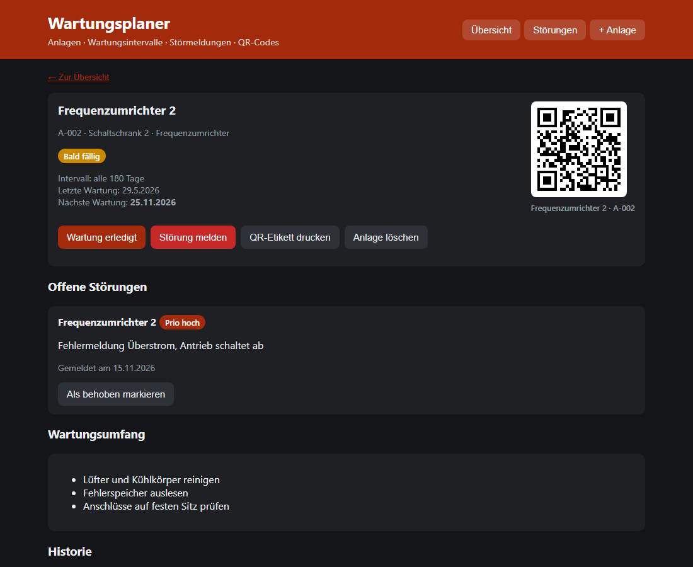

# 🔧 Wartungsplaner mit QR-Codes

Ein einfacher, digitaler Wartungsplaner für Betriebe und Werkstätten – ohne Server, ohne Installation, direkt im Browser und auf dem Handy.

**👉 Live-Demo:** https://tobias-hauser.github.io/wartungsplaner/

## Das Problem

In vielen Betrieben läuft die Wartungsplanung noch über Excel-Listen, Papier oder das Gedächtnis einzelner Kollegen. Die Folgen kennt jeder aus der Instandhaltung:

- Wartungen werden vergessen oder zu spät gemacht
- Bei einer Störung weiß niemand, was an der Anlage zuletzt gemacht wurde
- Störmeldungen gehen per Zuruf verloren

## Die Lösung

Jede Anlage bekommt einen **QR-Aufkleber**. Wer ihn mit dem Handy scannt, sieht sofort:

- ✅ **Status** – in Ordnung / bald fällig / überfällig (Ampelsystem)
- 📋 **Wartungsumfang** als Checkliste
- 🕓 **Historie** – alle Wartungen und Störungen mit Datum und Name
- ⚠️ **Störung melden** – direkt an der Anlage, mit Priorität

## Funktionen

| Funktion | Beschreibung |
|---|---|
| Übersicht mit Kennzahlen | Überfällige, bald fällige und offene Störungen auf einen Blick |
| Wartungsintervalle | Nächster Termin wird automatisch aus letzter Wartung + Intervall berechnet |
| Checkliste | Wartung kann erst gespeichert werden, wenn alle Punkte abgehakt sind |
| Störmeldungen | Melden, priorisieren und mit durchgeführter Maßnahme abschließen |
| QR-Etiketten | Pro Anlage ein QR-Code zum Ausdrucken und Aufkleben |
| Anlagen verwalten | Neue Anlagen anlegen und nicht mehr benötigte löschen (mit Sicherheitsabfrage) |
| Suche & Filter | Nach Anlage, Standort oder Status |
| Mobil | Funktioniert auf Handy, Tablet und PC |

## Technik

- Reines **HTML, CSS und JavaScript** – keine Installation, kein Server nötig
- Daten werden lokal im Browser gespeichert (`localStorage`)
- QR-Codes mit [qrcodejs](https://github.com/davidshimjs/qrcodejs)
- Gehostet über **GitHub Pages**

## Ausprobieren

1. Live-Demo öffnen (Link oben) – es sind Beispielanlagen hinterlegt
2. Eine Anlage anklicken → QR-Code mit dem Handy scannen
3. „Störung melden“ oder „Wartung erledigt“ ausprobieren
4. Über „Demo zurücksetzen“ ganz unten wieder auf die Beispieldaten zurück

## Ideen für die Weiterentwicklung

- Gemeinsame Datenbank, damit das ganze Team dieselben Daten sieht
- Erinnerung per E-Mail, wenn eine Wartung fällig wird
- Auswertung: welche Anlage fällt am häufigsten aus (MTBF / MTTR)
- Fotos zur Störmeldung anhängen

---

Entwickelt von **Tobias Hauser**, Mechatroniker (IHK) aus Freiburg – mit KI-Unterstützung.
Idee aus der Praxis: Wartung und Instandhaltung technischer Anlagen.
